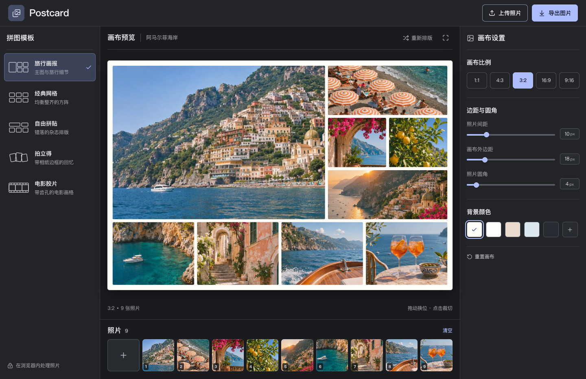
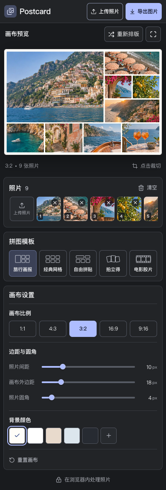

# Postcard · 旅行照片拼图

用 Postcard 把旅途中的照片排成一张明信片式拼图。打开编辑器即可用内置样片试排，也可以导入自己的横竖照片。照片的解码、裁切和导出均在浏览器内完成。



<details>
<summary>查看移动端截图</summary>



</details>

## 功能

- 五种模板随照片数量和方向调整布局，包括旅行画报、经典网格、自由拼贴、拍立得和电影胶片。
- 拖动照片排序或换位，逐张调整裁切位置与缩放，并可放大检查拼图。
- 支持方形、横向和竖向画布，可调整间距、外边距、圆角与背景色。
- 从原图渲染 PNG 或 JPG，导出长边可选 2560 或 4096 像素。

## 本地启动

需要 Node.js 22.18 或更新版本。

```sh
npm ci
npm run dev
```

如端口被占用，使用 Vite 终端显示的地址。[打开本地编辑器](http://127.0.0.1:5173/)

## 使用方法

桌面上，模板在画布左侧，画布设置在右侧，照片缩略图在下方。窄屏上，模板与设置移到画布和照片列表下方，缩略图可横向滑动。

1. 点击「上传照片」选择多张照片，也可以直接拖入编辑器。第一次上传成功后，自己的照片会替换内置样片。
2. 选择喜欢的拼图模板，或点击「重新排版」。拖动缩略图可排序，点击缩略图角落的 × 可删除。触屏设备上，长按缩略图再拖动可排序。
3. 在画布上用鼠标拖动未选中的照片，目标照片会高亮并显示「松开交换」。点击照片可调整缩放和位置，拖动已选中的照片可移动裁切位置。点击「完成裁切」后，该照片可以再次拖动换位。也可以调整画布比例、间距、外边距、圆角和背景。
4. 点击「导出图片」，选择 PNG 或 JPG，以及长边 2560 或 4096 像素。文件直接下载到本地。

模板根据照片数量和方向调整格子。裁切默认参考照片比例及构图位置，可以逐张微调。图片方向由浏览器解码器读取。编辑器使用缩小后的预览图，导出时逐张解码原文件，并使用与预览相同的排版和裁切逻辑。内置样片由 AI 生成，自有照片的最终清晰度取决于原图尺寸和裁切缩放程度。刷新页面会重置本次编辑。

## 技术与验证

项目使用 React、TypeScript、Vite 和 Tailwind CSS。布局计算在 `src/layout.ts`，预览和导出共用 `src/render.ts` 的 Canvas 渲染逻辑。

```sh
npm test
npm run build
npm run test:browser
```

浏览器测试需保持 Vite 服务运行，并安装 Google Chrome。测试会上传混合方向与格式的照片，验证 4、5、7、9、12 张的五种模板、排序、裁切与导出，并在 `test-results/` 保存截图和下载文件。可用 `POSTCARD_URL` 与 `POSTCARD_TEST_RESULTS` 更改测试地址和结果目录。
